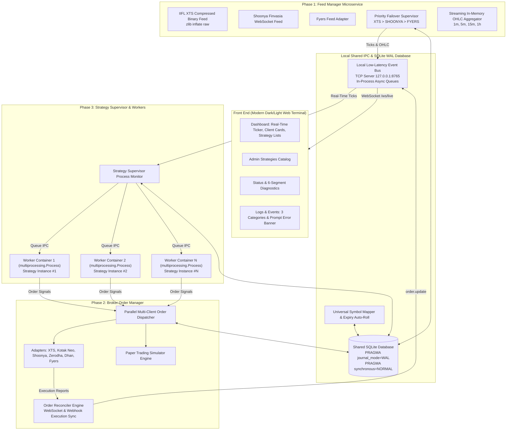

# Fresh Trade Engine: Master AI Agent & Developer Handbook
> **Repository**: `trande-engine-fresh`  
> **Target Audience**: AI Agents, LLM Coding Assistants, and Quantitative Trading System Engineers  
> **Primary Purpose**: Complete technical reference, component microservice architecture, local IPC protocols, database schemas, strategy process isolation container model, multi-broker order routing & reconciliation, live feed failover engine, and current implementation status roadmap.

---

## Table of Contents
1. [Project Executive Overview & Core Philosophy](#1-project-executive-overview--core-philosophy)
2. [Component Architecture & Inter-Process Topology](#2-component-architecture--inter-process-topology)
3. [Current Implementation & Readiness Matrix](#3-current-implementation--readiness-matrix)
4. [Repository File Tree & Code Sitemap](#4-repository-file-tree--code-sitemap)
5. [Database Architecture & Schema (SQLite WAL Mode)](#5-database-architecture--schema-sqlite-wal-mode)
6. [Local IPC Event Bus & Low-Latency Messaging](#6-local-ipc-event-bus--low-latency-messaging)
7. [Universal Symbol Mapper & Expiry Auto-Roll Engine](#7-universal-symbol-mapper--expiry-auto-roll-engine)
8. [Phase 1: Market Data Feed Manager (Microservice)](#8-phase-1-market-data-feed-manager-microservice)
9. [Phase 2: Broker Order Manager & Reconciler (Independent Module)](#9-phase-2-broker-order-manager--reconciler-independent-module)
10. [Phase 3: Strategy Manager & Process Containers (Independent Module)](#10-phase-3-strategy-manager--process-containers-independent-module)
11. [Web Trading Terminal & Frontend Architecture](#11-web-trading-terminal--frontend-architecture)
12. [REST API & WebSocket Specifications](#12-rest-api--websocket-specifications)
13. [How to Run, Test, and Operate](#13-how-to-run-test-and-operate)
14. [Agent Implementation Guide: Extending the Engine](#14-agent-implementation-guide-extending-the-engine)
15. [Pending Roadmap & Incomplete Work Items](#15-pending-roadmap--incomplete-work-items)

---

## 1. Project Executive Overview & Core Philosophy

**Fresh Trade Engine** is a high-performance, fault-proof algorithmic trading platform designed specifically for the multi-broker Indian financial markets (NSE, NFO, BSE, BSEFO, MCX, MCXFO).

### Core Design Principles:
1. **Zero Network Latency Between Components**: All 3 engine phases (Market Data Feed Manager, Broker Order Manager, and Strategy Manager) run on the same local host. They communicate via an in-memory/local TCP socket event bus (`127.0.0.1:8765`) and a shared SQLite database in WAL (Write-Ahead Logging) mode, completely bypassing slow external HTTP microservice calls.
2. **Process Container Isolation for Strategies**: Every strategy instance runs inside its own dedicated OS process (`multiprocessing.Process`). If a strategy encounters an unhandled exception, syntax bug, memory leak, or gets updated on the fly, **it will never crash the main engine or affect any other strategy**.
3. **Hot Market Feed Failover**: Market data feeds continuously monitor socket health and heartbeat latency. If the primary broker feed (e.g. IIFL XTS) drops or experiences timeout, the engine automatically switches to standby feeds (Shoonya Finvasia $\rightarrow$ Fyers) without losing state or dropping instrument subscriptions.
4. **Universal Symbol Canonicalization**: Strategies operate entirely on clean canonical symbols (e.g., `NSE:NIFTY`, `BSE:SENSEX`, `MCX:CRUDEOIL`, `NFO:BANKNIFTY52000CE`). The Universal Symbol Mapper automatically resolves these to broker-specific exchange tokens and trading symbols across all supported brokers.
5. **Parallel Multi-Client Order Routing**: When a single strategy generates an entry or exit signal, orders are dispatched concurrently across all mapped client accounts without head-of-line blocking.
6. **Dual Role & Zero Noise Interface**: The UI cleanly distinguishes between **ADMIN** (viewing raw strategy keys, system internals, template registers, and diagnostics) and **USER** (viewing clean, un-slugged strategy names and account metrics). Critical errors trigger a prominent, sticky dismissable top banner.

---

## 2. Component Architecture & Inter-Process Topology



---

## 3. Current Implementation & Readiness Matrix

Because this is an active project that is not yet 100% complete, any agent working on this codebase must understand what is functional vs. scaffolded:

| Component / Subsystem | Status | Current Implementation Details | Next Steps / Incomplete Items |
| :--- | :--- | :--- | :--- |
| **SQLite WAL DB** | ✅ Complete | Tables: `accounts`, `strategy_templates`, `strategy_instances`, `orders`, `trades`, `positions`, `symbol_mappings`, `system_logs`, `feed_broker_statuses`. Seed data auto-populates. | Add migration framework (e.g. Alembic) if schemas change. |
| **Local Event Bus / IPC** | ✅ Complete | In-process asyncio queue & callbacks + TCP broadcast socket (`127.0.0.1:8765`) for multi-terminal execution. | Add encryption or auth token if binding outside localhost. |
| **Symbol Mapper & Auto-Roll** | ✅ Complete | Canonical mapping across 6 segments (`NSE`, `NFO`, `BSE`, `BSEFO`, `MCX`, `MCXFO`). Auto-roll scans MCX futures expiry dates and rolls to next month contract. | Integrate automatic token download script from broker master lists. |
| **Feed Manager Failover** | ✅ Complete | Standby broker connection, dynamic priority list (`XTS` > `SHOONYA` > `FYERS`), manual `/api/status/feed/failover` and heartbeat health loop. | Real network reconnect retry backoff if both internet & brokers go down. |
| **IIFL XTS Feed Adapter** | ✅ Complete | Binary market data streaming adapter with zlib raw decompression (`pako_inflate_raw`), automatic instrument unsubscription before resubscribing. | Verify binary struct unpacking with live market depth packets. |
| **Shoonya Feed Adapter** | ✅ Complete | Live credential auth ready, fallback ticker simulation when offline. | Wire live NorenApi WebSocket callbacks for production live feed. |
| **Fyers Feed Adapter** | 🟡 Functional / Standby | Base structure and subscription handlers ready. | Complete Fyers V3 data socket auth flow. |
| **OHLC Candle Aggregator** | ✅ Complete | In-memory bar builder for `1m`, `5m`, `15m`, `1h` intervals with current building bar support. | Add disk persistence for historical OHLC candles if engine restarts. |
| **Strategy Supervisor** | ✅ Complete | Spawns isolated `multiprocessing.Process` per strategy, polls worker queues, captures crashes, auto-restarts saved running strategies. | Add CPU affinity / core pinning for extreme high frequency strategies. |
| **Strategy Decision Logs** | ✅ Complete | Chronological audit steps (`Candle Fetch Success`, `ENTRY CONDITION MATCH`, `ORDER SENT`, `ORDER FILLED`, `TRADE ACTIVE`, `TRACKING SL/TARGET`). | Persist raw tick snapshots alongside decision logs for replay. |
| **Strategy Duplication** | ✅ Complete | POST `/api/strategies/{id}/duplicate` clones parameters and creates independent instance. | UI modal form pre-filling custom leg strikes on duplication. |
| **Registered Strategies** | ✅ Complete | 3 templates registered: EMA Crossover, 0DTE Short Straddle (multi-leg CE/PE), Supertrend MCX. | Add more algorithmic templates (Iron Condor, VWAP Mean Reversion, Breakout). |
| **Broker Order Manager** | ✅ Complete | Multi-client parallel dispatch, order tracking, universal symbol translation. | Connect live REST endpoints for Zerodha Kite, Kotak Neo, Dhan, Fyers. |
| **Paper Trading Simulation** | ✅ Complete | Realistic fill prices, slippage simulation, mark-to-market position PnL calculations. | Configurable simulated slippage and latency parameters. |
| **Order Reconciler** | ✅ Complete | WebSocket/Webhook execution report handler, trade creation, position mark-to-market sync. | Add automated broker orderbook polling reconciler fallback every 30s. |
| **Web Dashboard UI** | ✅ Complete | Real-time ticker row, U/R/T header PnL widget, Client Cards with side drawer, Strategy list table, Strategy Chart modal, Decision timeline modal. | Visual candlestick overlay indicators on the chart modal. |
| **Role Visibility (Admin vs User)**| ✅ Complete | Admin sees raw keys & slugs; User sees clean names without technical slugs. | Add user login/auth tokens (JWT) to enforce role server-side. |
| **Status & Diagnostics Suite** | ✅ Complete | Interactive UI test suite for 6 segments Feed & Order execution tests. | Add scheduled daily pre-market health auto-runner at 09:00 AM. |
| **Logs & Dismissable Banner** | ✅ Complete | 3 categories (Broker API, Feed Subscription, Strategy Decision) + Sticky top prompt error banner with instant dismiss. | Log export to CSV / JSON download. |

---

## 4. Repository File Tree & Code Sitemap

```text
trade-engine-fresh\
├── .env                              # Active broker credentials & server configurations
├── .env.example                      # Template environment variables
├── ARCHITECTURE.md                   # High-level architecture documentation
├── AGENTS.md                         # (This File) Master AI Agent & Developer Handbook
├── AGENT_SYSTEM_HANDBOOK.md          # In-depth architectural & operational handbook mirror
├── New Text Document.txt             # Original user requirements & functional specifications
├── start_unified_engine.bat          # 1-Click launcher: runs entire engine in single terminal
├── start_all_separate_terminals.bat  # 1-Click launcher: runs 4 independent terminal microservices
├── test_engine.py                    # Automated end-to-end integration test suite
│
├── backend/                          # Core Python Engine
│   ├── config.py                     # Global constants, paths, default instruments, priorities
│   ├── run.py                        # Unified launcher (starts DB, Feed, Orders, Strats, API)
│   ├── run_feed.py                   # Terminal 1: Feed Manager standalone process
│   ├── run_strategies.py             # Terminal 2: Strategy Supervisor standalone process
│   ├── run_order_manager.py          # Terminal 3: Order Manager & Reconciler standalone process
│   ├── run_web.py                    # Terminal 4: Web Dashboard & FastAPI server standalone
│   │
│   ├── api/                          # FastAPI REST API & WebSocket Server
│   │   ├── __init__.py
│   │   └── app.py                    # All endpoints, WebSocket `/ws/live`, telemetry, actions
│   │
│   ├── core/                         # Core Shared Low-Latency Infrastructure
│   │   ├── __init__.py
│   │   ├── events.py                 # LocalEventBus (In-process asyncio + TCP socket IPC server/client)
│   │   └── symbol_mapper.py          # UniversalSymbolMapper & MCX Commodity Expiry Auto-Roll
│   │
│   ├── database/                     # Shared SQLite WAL Storage Layer
│   │   ├── __init__.py
│   │   ├── connection.py             # SQLite engine with WAL pragma listener & seed generator
│   │   └── models.py                 # SQLAlchemy ORM models (Account, Order, Trade, Position, etc.)
│   │
│   ├── feed_manager/                 # Phase 1: Market Data Feed Microservice
│   │   ├── __init__.py
│   │   ├── manager.py                # FeedManager supervisor, Failover engine & OHLCBuilder
│   │   ├── xts_binary/               # Symphony binary packet deserializers
│   │   └── brokers/                  # Broker feed adapters
│   │       ├── __init__.py
│   │       ├── base_feed.py          # BaseFeedBroker abstract class
│   │       ├── xts_feed.py           # IIFL XTS Binary WebSocket Feed adapter
│   │       ├── shoonya_feed.py       # Shoonya (Finvasia) WebSocket Feed adapter
│   │       └── fyers_feed.py         # Fyers Data Feed adapter
│   │
│   ├── order_manager/                # Phase 2: Broker Order Execution Module
│   │   ├── __init__.py
│   │   ├── manager.py                # OrderManager: multi-client parallel router & emergency square-off
│   │   ├── reconciler.py             # OrderReconciler: socket/webhook execution handler
│   │   └── brokers/                  # Broker execution adapters
│   │       ├── __init__.py
│   │       ├── base_order.py         # BaseOrderBroker abstract class
│   │       └── broker_adapters.py    # XTS, KotakNeo, Shoonya, Zerodha, Dhan, Fyers adapters
│   │
│   └── strategy_manager/             # Phase 3: Strategy Process Containers & Supervisor
│       ├── __init__.py
│       ├── manager.py                # StrategySupervisor: process lifecycle, dispatch, auto-start
│       ├── worker.py                 # strategy_process_entrypoint (Isolated OS process container)
│       ├── base_strategy.py          # BaseStrategy: lifecycle, on_candle, on_tick, log_decision
│       └── registered/               # Registered strategy algorithm implementations
│           ├── __init__.py
│           ├── ema_crossover.py      # Trend following EMA 9/21 strategy
│           ├── short_straddle.py     # 0DTE Short Straddle multi-leg CE+PE strategy
│           └── supertrend_mcx.py     # MCX Commodity Supertrend strategy
│
├── data/                             # Runtime SQLite Database Directory
│   ├── trade_engine.db               # SQLite database file
│   ├── trade_engine.db-wal           # SQLite Write-Ahead Log
│   └── trade_engine.db-shm           # SQLite shared memory
│
└── frontend/                         # Modern Trading Terminal UI (Vanilla JS/CSS)
    ├── index.html                    # Single-page terminal UI with modals & drawers
    ├── css/
    │   └── style.css                 # Dark & Light theme tokens, glassmorphism, responsive grid
    └── js/
        ├── app.js                    # App controller, WebSocket connection, role & theme switcher
        ├── ticker.js                 # Real-time streaming ticker track with tick flashes
        ├── client_cards.js           # Multi-broker client cards grid, live/paper switch, side drawer
        ├── strategies.js             # Strategy table, multi-leg views, chart & duplicate modals
        ├── status_page.js            # Feed health monitoring, manual failover, 6-segment test suite
        └── logs_page.js              # 3-part log tables, strategy filter, dismissable error banner
```

---

## 5. Database Architecture & Schema (SQLite WAL Mode)

The database file resides at `data/trade_engine.db`. Because multiple independent terminal processes read and write simultaneously, SQLite is configured with **Write-Ahead Logging (WAL)**.

### SQLite Concurrency Pragma Setup ([`connection.py`](./backend/database/connection.py))
```python
@event.listens_for(engine, "connect")
def set_sqlite_pragma(dbapi_connection, connection_record):
    cursor = dbapi_connection.cursor()
    cursor.execute("PRAGMA journal_mode=WAL")       # Enables concurrent readers & single writer
    cursor.execute("PRAGMA busy_timeout=5000")      # Waits up to 5s before throwing lock error
    cursor.execute("PRAGMA synchronous=NORMAL")     # Drastically increases write speed safely
    cursor.close()
```

### Table Schemas Overview ([`models.py`](./backend/database/models.py))

1. **`accounts`**:
   - `id` (PK, Int), `broker` (`XTS`, `KOTAKNEO`, `SHOONYA`, `ZERODHA`, `DHAN`, `FYERS`).
   - `client_id` (Unique Str), `client_name` (Str), `paper_mode` (Bool, default True).
   - `is_active` (Bool), `is_logged_in` (Bool), `credentials_json` (JSON).
   - `margin_available` (Float), `margin_used` (Float), `total_balance` (Float).
2. **`strategy_templates`**:
   - `key` (Unique Str, e.g. `strat_short_straddle_v2` - admin only).
   - `name_admin` (Str, technical name), `name_user` (Str, clean user name without slug).
   - `default_config` (JSON), `python_module` (Str).
3. **`strategy_instances`**:
   - `id` (PK, Int), `template_key` (FK to template).
   - `instance_name_admin` (Str), `instance_name_user` (Str).
   - `client_ids` (JSON List of client IDs mapped for parallel order dispatch).
   - `status` (`RUNNING`, `STOPPED`, `ERROR`), `config` (JSON).
   - `unrealized_pnl`, `realized_pnl`, `total_pnl` (Float).
   - `legs_info` (JSON: multi-leg breakdown with entry, exit, LTP, and leg PnL).
4. **`orders`**:
   - `order_id` (Unique Str: engine ID `ORD_YYYYMMDDHHMMSS_xxxxxx`), `broker_order_id` (Str).
   - `client_id` (FK to account), `strategy_instance_id` (FK to instance).
   - `symbol` (Canonical, e.g. `NSE:NIFTY`), `segment` (`NSE`, `NFO`, `BSE`, `BSEFO`, `MCX`, `MCXFO`).
   - `side` (`BUY`/`SELL`), `order_type` (`MARKET`/`LIMIT`/`SL`), `product` (`MIS`/`NRML`).
   - `quantity` (Int), `price` (Float), `status` (`NEW`, `PENDING`, `FILLED`, `REJECTED`, `CANCELLED`).
   - `is_paper` (Bool), `leg_id` (Str, e.g. `LEG_1_CE`).
5. **`trades`**:
   - `trade_id` (Unique Str), `order_id` (FK to order), `client_id`, `strategy_instance_id`.
   - `symbol`, `segment`, `side`, `quantity`, `price`, `timestamp`.
6. **`positions`**:
   - Mark-to-market positions per client and strategy instance with real-time unrealized and realized PnL.
7. **`symbol_mappings`**:
   - Canonical symbol resolver across all 6 brokers, lot sizes, tick sizes, expiry dates, commodity flags.
8. **`system_logs`**:
   - Category (`BROKER_API`, `FEED_SUBSCRIPTION`, `STRATEGY_DECISION`), level (`INFO`, `SUCCESS`, `WARNING`, `ERROR`, `DATA_RECEIVING`, `EMPTY_RESULT`).
   - `is_dismissed` (Bool, false for prompt errors until explicitly dismissed by user).
9. **`feed_broker_statuses`**:
   - Live health tracking of `XTS`, `SHOONYA`, `FYERS` (latency, packet count, active/standby status).

---

## 6. Local IPC Event Bus & Low-Latency Messaging

The engine utilizes [`LocalEventBus`](./backend/core/events.py).

### Dual Operation Modes:
1. **In-Process Mode (`start_unified_engine.bat`)**:
   - Direct Python `asyncio` callbacks and queues. Zero serialization overhead. Sub-microsecond dispatch.
2. **Multi-Terminal Mode (`start_all_separate_terminals.bat`)**:
   - Terminal 1 (Feed Manager) starts a local TCP IPC server on `127.0.0.1:8765`.
   - Terminals 2, 3, and 4 connect as IPC clients via `start_ipc_client()`.
   - Real-time market ticks, order updates, and strategy events are pushed over local loopback TCP with sub-millisecond delivery.

### Standard Published Topics:
- `feed.tick`: Real-time tick dict (`{"symbol": "NSE:NIFTY", "ltp": 22485.0, "change": 15.5, ...}`).
- `feed.status`: Health snapshot of all connected feed brokers.
- `order.update`: Order reconciliation event pushed to UI and Strategy Supervisor.
- `strategy.event`: Decision logs or status changes emitted by strategy processes.

---

## 7. Universal Symbol Mapper & Expiry Auto-Roll Engine

Located at [`backend/core/symbol_mapper.py`](./backend/core/symbol_mapper.py).

### Canonical Symbol Format:
All strategies and UI components use canonical format: `<EXCHANGE_OR_SEGMENT>:<SYMBOL_OR_CONTRACT>`:
- `NSE:NIFTY`
- `NSE:BANKNIFTY`
- `BSE:SENSEX`
- `NFO:BANKNIFTY52000CE`
- `MCX:CRUDEOIL`
- `MCX:NATURALGAS`
- `MCX:GOLD`
- `MCX:SILVER`

### Commodity Futures Auto-Roll Logic:
Per user requirement: *"CRUDEOIL, NATURALGAS, GOLD, SILVER -> Current Month Future. Future should change automatically on next day of expiry."*
- `check_and_roll_expiries()` scans all commodity futures in `symbol_mappings`.
- Standard expiry calendar rules:
  - **CRUDEOIL**: Expires ~19th of contract month.
  - **NATURALGAS**: Expires ~25th of contract month.
  - **GOLD / SILVER**: Expires ~5th of delivery month.
- When `current_date > expiry_date`, the mapper automatically updates the contract display name, advances the expiry date to the next month, and updates broker tokens in the database.

---

## 8. Phase 1: Market Data Feed Manager (Microservice)

Implemented in [`backend/feed_manager/manager.py`](./backend/feed_manager/manager.py).

### 1. Multi-Broker Priority & Failover:
- **Priority List**: `["XTS", "SHOONYA", "FYERS"]`.
- The Feed Manager initializes all brokers. `XTS` is selected as the primary active source.
- Both `SHOONYA` and `FYERS` stay connected in standby mode.
- If `XTS` drops or its heartbeat fails (`FEED_HEARTBEAT_TIMEOUT_SEC = 5.0`), `failover_to_next()` activates `SHOONYA` and seamlessly restores all active subscriptions.

### 2. IIFL XTS Binary WebSocket Feed ([`xts_feed.py`](./backend/feed_manager/brokers/xts_feed.py)):
- Connects to IIFL Blaze compressed binary endpoint (`/apibinarymarketdata`).
- Decompresses binary payloads using `pako_inflate_raw` (`zlib.decompressobj(-15)`).
- Automatically executes unsubscriptions before resubscribing to avoid the Symphony `"Instrument Already Subscribed"` error and frozen tickers.

### 3. In-Memory Streaming OHLC Aggregator (`OHLCBuilder`):
- Aggregates streaming ticks into `1m`, `5m`, `15m`, and `1h` resolution bars in real time.
- Keeps up to 300 completed bars in-memory for immediate strategy indicator calculations.
- Exposes `get_bars(symbol, resolution, count)` including the currently building bar.

---

## 9. Phase 2: Broker Order Manager & Reconciler (Independent Module)

Implemented in [`backend/order_manager/manager.py`](./backend/order_manager/manager.py).

### Key Features:
1. **Supported Brokers**: XTS, Kotak Neo, Shoonya, Zerodha, Dhan, Fyers.
2. **Parallel Multi-Client Routing**: When a strategy instance emits an order signal, `order_manager.place_order_for_clients(client_ids, ...)` launches concurrent `asyncio.gather()` tasks so all accounts execute simultaneously with zero delay.
3. **Paper vs. Live Mode Switcher**:
   - Each client card in `accounts` has a `paper_mode` flag.
   - When `paper_mode = True`, fills are executed through the internal simulation engine using live market tick prices.
   - When `paper_mode = False`, orders route to the broker's API adapter.
4. **Order Reconciliation Engine ([`reconciler.py`](./backend/order_manager/reconciler.py))**:
   - Receives broker execution reports (fills, rejections, cancellations).
   - Generates `trades` records, updates mark-to-market `positions`, logs execution status to `system_logs`, and broadcasts `order.update` over the event bus.
5. **Emergency Square-Off**:
   - **Account Level**: Single-click button squares off all open positions for that client account.
   - **Strategy Level**: Single-click button closes all trades and stops the strategy process.

---

## 10. Phase 3: Strategy Manager & Process Containers (Independent Module)

Implemented in [`backend/strategy_manager/manager.py`](./backend/strategy_manager/manager.py) and [`worker.py`](./backend/strategy_manager/worker.py).

### Process Container Isolation:
- Every active strategy runs inside an independent OS process created via `multiprocessing.Process`.
- Communication with the supervisor occurs through two thread-safe `multiprocessing.Queue` objects:
  - `in_queue`: Supervisor sends `TICK`, `CANDLE`, and `STOP` commands.
  - `out_queue`: Worker sends `STATUS`, `DECISION_LOG`, `ERROR`, and order requests.
- **Fault-Proof**: If a strategy throws an unhandled exception or encounters an infinite loop, only that worker process fails; the main engine and other strategies remain completely unaffected.

### Base Strategy Class ([`base_strategy.py`](./backend/strategy_manager/base_strategy.py)):
Any strategy inherits from `BaseStrategy` and implements:
- `on_init()`: Setup indicators, strikes, and state.
- `on_candle(candle, history)`: Bar-based logic.
- `on_tick(tick)`: Real-time price tracking and trailing stop-loss.
- `log_decision(step, details, level)`: Appends to the chronological decision audit trail.

### Chronological Decision Audit Trail:
Every strategy logs its exact execution flow:
```text
1. Candle Fetch Success
2. ENTRY CONDITION MATCH / NOT MATCH
3. ORDER SENT TO BROKER
4. ORDER FILLED / FAILED
5. TRADE ACTIVE
6. TRACKING SL / TARGET
```

### Multi-Leg Price Tracking:
In strategies like [ShortStraddleStrategy](./backend/strategy_manager/registered/short_straddle.py), both Call and Put legs are tracked independently:
```json
[
  {"leg": "BANKNIFTY CE 52000", "entry": 245.0, "exit": null, "ltp": 241.5, "qty": -30, "pnl": 105.0},
  {"leg": "BANKNIFTY PE 52000", "entry": 258.0, "exit": null, "ltp": 262.0, "qty": -30, "pnl": -120.0}
]
```

### Strategy Duplication:
The engine provides an API (`POST /api/strategies/{id}/duplicate`) to clone an existing strategy configuration with custom parameters (e.g. changing timeframe from 5m to 15m, or symbol from NIFTY to BANKNIFTY) while keeping the tested core logic identical.

---

## 11. Web Trading Terminal & Frontend Architecture

The frontend is a vanilla JavaScript single-page application located in [`frontend/`](./frontend/).

### Views and Modules:
1. **Header ([`app.js`](./frontend/js/app.js))**:
   - Consolidated PnL widget: **U** (Unrealized), **R** (Realized), **T** (Total).
   - Role Switcher: **ADMIN** vs **USER**.
     - In **USER** mode, technical slugs and keys (`strat_ema_cross_v1`) are hidden; only human-friendly names (`Trend Momentum Alpha`) are shown.
     - In **ADMIN** mode, all raw keys and internal identifiers are exposed.
   - Dark / Light theme toggle.
   - Live WebSocket pulse indicator.
2. **Streaming Ticker Row ([`ticker.js`](./frontend/js/ticker.js))**:
   - Displays real-time prices for default instruments (`NIFTY`, `BANKNIFTY`, `SENSEX`, `CRUDEOIL`, `NATURALGAS`, `GOLD`, `SILVER`).
   - Dynamic green/red flash animations on price ticks.
3. **Client Cards Grid & Side Drawer ([`client_cards.js`](./frontend/js/client_cards.js))**:
   - Account status across brokers with Live/Paper switcher and emergency **SQUARE OFF** button.
   - Side drawer with tabs for **Positions (Net/Day)**, **OrderBook**, **Executed Trades**, **Holdings**, and **Margins/Balance**.
4. **Strategy Lists Table ([`strategies.js`](./frontend/js/strategies.js))**:
   - Strategy status, mapped client badges, last trade status, start/end times, U/R/T PnL, multi-leg price pills.
   - Action menu: Enable/Disable, Square Off, Chart Modal (Chart.js), Recent Trades Modal, Decision Audit Timeline Modal, Duplicate Modal.
5. **Strategies Catalog (Admin Only)**:
   - Registry of coded strategy templates ready to map to clients.
6. **Status & Diagnostics Page ([`status_page.js`](./frontend/js/status_page.js))**:
   - Broker Feed Health cards with latency, packet counts, and a **TRIGGER MANUAL FAILOVER** button.
   - Diagnostic Test Suites:
     - **Test 1**: Symbol subscription and OHLC fetch for 1 symbol across all 6 segments (`NSE`, `NFO`, `BSE`, `BSEFO`, `MCX`, `MCXFO`).
     - **Test 2**: Real-time order execution test across all 6 segments.
7. **Logs & Events Page ([`logs_page.js`](./frontend/js/logs_page.js))**:
   - Zero-noise single table divided into 3 category tabs:
     - `BROKER_API` (ERROR / SUCCESS)
     - `FEED_SUBSCRIPTION` (ERROR / SUCCESS / DATA_RECEIVING / EMPTY_RESULT)
     - `STRATEGY_DECISION`
   - Strategy-level filter dropdown.
   - **Sticky Top Prompt Error Banner**: Critical errors are pinned to the top of the screen with a **DISMISS** button so issues are resolved immediately.

---

## 12. REST API & WebSocket Specifications

Server runs on `http://127.0.0.1:8000`. Full endpoint implementation in [`backend/api/app.py`](./backend/api/app.py).

### Core REST Endpoints:
- `GET /api/dashboard`: Summary stats, consolidated U/R/T PnL, active client count, running strategy count.
- `GET /api/accounts`: List all client accounts, margins, and running strategy counts.
- `POST /api/accounts/{client_id}/toggle-mode`: Toggle account between Paper and Live execution mode.
- `POST /api/accounts/{client_id}/square-off`: Emergency square-off for all positions in account.
- `GET /api/accounts/{client_id}/details`: Positions, orders, trades, and margins for side drawer.
- `GET /api/strategies/templates`: List registered strategy templates (Admin view).
- `GET /api/strategies/instances`: List configured strategy instances.
- `POST /api/strategies/{id}/toggle`: Start or stop a strategy process container.
- `POST /api/strategies/{id}/duplicate`: Duplicate an existing strategy with custom parameters.
- `POST /api/strategies/{id}/square-off`: Emergency square-off for a specific strategy.
- `GET /api/strategies/{id}/audit`: Fetch chronological decision trail for strategy modal.
- `GET /api/status/feed`: Feed health snapshot and broker priority list.
- `POST /api/status/feed/failover`: Trigger manual failover to next broker.
- `POST /api/status/diagnostics/run-feed-test`: Run 6-segment symbol subscription & OHLC diagnostic.
- `POST /api/status/diagnostics/run-order-test`: Run 6-segment order execution diagnostic.
- `GET /api/logs`: Fetch system logs with category and strategy filters, plus active undismissed errors.
- `POST /api/logs/{id}/dismiss`: Dismiss a prompt error banner.
- `POST /api/logs/dismiss-all`: Dismiss all prompt errors.

### WebSocket Endpoint:
- `ws://127.0.0.1:8000/ws/live`: Real-time streaming pipeline for Ticks, Feed Status, Order Updates, and Strategy Events.

---

## 13. How to Run, Test, and Operate

### Prerequisites:
- Python 3.10+
- Installed packages: `fastapi`, `uvicorn`, `sqlalchemy`, `websockets`, `python-dotenv`, `requests`.

### Option A: 1-Click Unified Engine (Recommended for Development)
Runs all services in a single Python process:
```bash
start_unified_engine.bat
# Or manually:
python backend/run.py
```
Open your browser at `http://127.0.0.1:8000`.

### Option B: Multi-Terminal Microservices (Recommended for Production Simulation)
Launches each microservice in its own terminal window:
```bash
start_all_separate_terminals.bat
```
This spawns:
- **Terminal 1**: `python backend/run_feed.py` (Feed Manager + TCP IPC Broadcast Server)
- **Terminal 2**: `python backend/run_strategies.py` (Strategy Supervisor + Process Containers)
- **Terminal 3**: `python backend/run_order_manager.py` (Order Manager & Reconciler)
- **Terminal 4**: `python backend/run_web.py` (Web Dashboard & FastAPI Server)

### Running Automated Test Suite:
```bash
python test_engine.py
```
This tests:
1. Dashboard summary calculation.
2. Account listing & paper/live toggle.
3. Strategy instances & templates.
4. Feed Manager status & automatic failover.
5. Diagnostics Test 1 (All 6 Segments Feed Subscription & OHLC).
6. Diagnostics Test 2 (All 6 Segments Order Execution).
7. Strategy duplication.
8. Logs & prompt error banner dismissal.

---

## 14. Agent Implementation Guide: Extending the Engine

### How to Add a New Strategy Algorithm:
1. Create a new file in `backend/strategy_manager/registered/<strategy_slug>.py`.
2. Subclass `BaseStrategy`:
   ```python
   from backend.strategy_manager.base_strategy import BaseStrategy

   class MyCustomStrategy(BaseStrategy):
       def on_init(self):
           self.log_decision("INIT", "Custom Strategy Initialized")

       def on_candle(self, candle, history):
           self.log_decision("Candle Fetch Success", f"Bar close: {candle['close']}")
           # Check entry condition...
           if condition_met:
               self.log_decision("ENTRY CONDITION MATCH", "Entry trigger fired")

       def on_tick(self, tick):
           # Track trailing SL / target...
           pass
   ```
3. Register the class mapping in `MODULE_CLASS_MAP` in [`backend/strategy_manager/manager.py`](./backend/strategy_manager/manager.py).
4. Insert a template entry into `strategy_templates` in [`backend/database/connection.py`](./backend/database/connection.py).

### How to Connect a Live Broker Order API:
1. Open [`backend/order_manager/brokers/broker_adapters.py`](./backend/order_manager/brokers/broker_adapters.py).
2. Locate the broker class (e.g., `KotakNeoOrderBroker` or `ZerodhaOrderBroker`).
3. Replace the placeholder simulated return in `place_order()` with the broker's official SDK or HTTP REST call.
4. When execution callbacks are received from the broker's WebSocket or Webhook, pass the payload to `reconciler.handle_execution_report(report)`.

---

## 15. Pending Roadmap & Incomplete Work Items

For any agent assigned to complete this new project, here is the prioritized backlog:

1. **Broker Live API Integrations**:
   - Complete live order placement HTTP handlers in `broker_adapters.py` for Zerodha Kite Connect, Kotak Neo, Dhan HQ, and Fyers API v3.
   - Implement official webhook receiver endpoints (`POST /api/webhooks/{broker}`) in `app.py` to route execution reports directly into `reconciler.py`.
2. **Historical OHLC Candle Persistence**:
   - Currently, `OHLCBuilder` stores candles in-memory. If the engine restarts, bars are rebuilt from incoming ticks. Add a table (`historical_candles`) to persist closed 1m/5m/15m/1h candles to SQLite.
3. **Automated Token Master Ingestion**:
   - Build a daily cron script (`scripts/download_masters.py`) to download master instrument CSVs from NSE, BSE, MCX, and broker endpoints, automatically updating `symbol_mappings`.
4. **Strategy UI Modal Form**:
   - Enhance the frontend "Add Strategy" and "Duplicate Strategy" modals with dynamic strike selectors and risk limit fields.
5. **Pre-Market Diagnostics Auto-Scheduler**:
   - Implement a scheduler task that automatically runs Diagnostics Test 1 (Feed) and Test 2 (Orders) at 09:00 AM IST and alerts the admin if any exchange segment fails.
