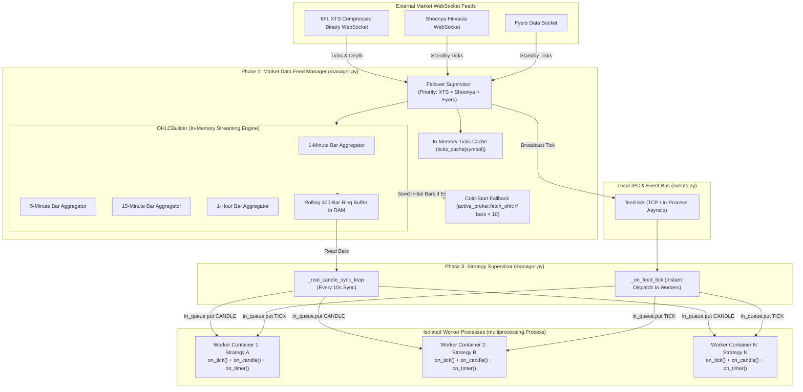
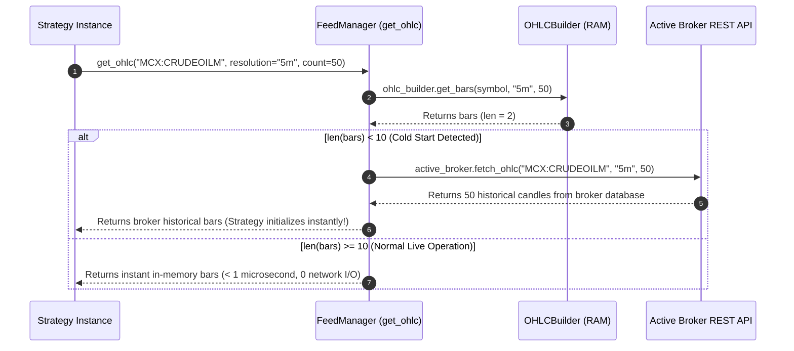
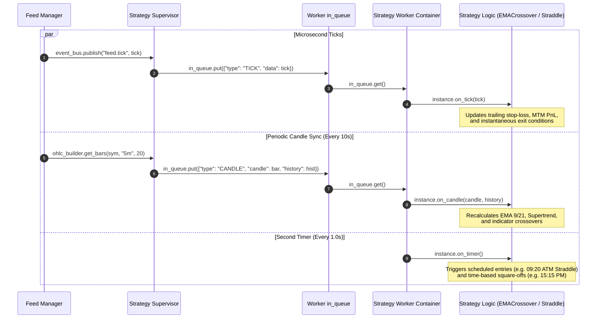

# Candle Fetching & In-Memory Streaming Aggregation Architecture

> **Document Version**: 1.0.0  
> **Target Audience**: Quant Engineers, Strategy Developers, System Administrators  
> **Repository**: `trade-engine-fresh`  
> **Components Covered**: `backend/feed_manager/manager.py`, `backend/strategy_manager/manager.py`, `backend/strategy_manager/worker.py`, `backend/strategy_manager/base_strategy.py`

---

## Table of Contents
1. [Executive Summary & Core Philosophy](#1-executive-summary--core-philosophy)
2. [End-to-End Architectural Data Flow](#2-end-to-end-architectural-data-flow)
3. [Deep-Dive: In-Memory OHLC Streaming Aggregator (`OHLCBuilder`)](#3-deep-dive-in-memory-ohlc-streaming-aggregator-ohlcbuilder)
4. [Hybrid Cold-Start Historical Fallback](#4-hybrid-cold-start-historical-fallback)
5. [Strategy Worker Process Container Routing](#5-strategy-worker-process-container-routing)
6. [Why This Design Outperforms Periodic REST Polling](#6-why-this-design-outperforms-periodic-rest-polling)
7. [How to View this Document (Diagrams & Markdown Preview)](#7-how-to-view-this-document-diagrams--markdown-preview)

---

## 1. Executive Summary & Core Philosophy

In algorithmic trading, strategies rely on two primary types of market inputs:
1. **Microsecond Ticks**: Real-time Last Traded Price (LTP), best bid/ask, and volume for instantaneous entry triggers, stop-loss checks, trailing SLs, and Mark-to-Market (MTM) calculations.
2. **Aggregated OHLC Candles**: Consolidated bars (e.g. 1-minute, 5-minute, 15-minute, 1-hour) for technical indicators such as Exponential Moving Averages (EMA 9/21), Supertrend, RSI, MACD, and Bollinger Bands.

### The Problem with Traditional REST Polling:
Most retail trading bots query broker REST endpoints every minute to download candle data (`GET /api/candles?interval=1m`). This naive approach introduces severe flaws:
- **Broker Rate Limits**: Exceeding 1–3 requests per second triggers HTTP `429 Too Many Requests` or temporary IP bans during peak market hours (09:15 – 09:30 AM).
- **Network Latency Jitter**: HTTP handshakes, SSL negotiation, and broker database queries introduce 200ms–1500ms delay per candle fetch, resulting in slippage and delayed order entries.
- **Connection Drops**: If the broker REST server is overloaded, the strategy misses candle completions and fails to generate trading signals.

### The Fresh Trade Engine Solution:
**Fresh Trade Engine** operates on a **Continuous Streaming In-Memory Aggregation** model:
- The **Market Data Feed Manager** maintains persistent binary/WebSocket connections to the active broker (`IIFL XTS`, `Shoonya Finvasia`, or `Fyers`).
- Every streaming tick packet is pushed through an in-memory bar builder ([`OHLCBuilder`](file:///backend/feed_manager/manager.py#L18-L76)) running in RAM.
- Bars for `1m`, `5m`, `15m`, and `1h` resolutions are updated dynamically in sub-microseconds without making external network calls.
- Completed bars and the currently-forming bar are delivered to isolated strategy OS worker processes via low-latency inter-process queues (`multiprocessing.Queue`).

---

## 2. End-to-End Architectural Data Flow



---

## 3. Deep-Dive: In-Memory OHLC Streaming Aggregator (`OHLCBuilder`)

Implemented in [`backend/feed_manager/manager.py`](file:///backend/feed_manager/manager.py#L18-L76).

### 1. Data Structure in RAM
```python
self.candles: Dict[str, Dict[str, List[Dict[str, Any]]]] = {}
# Structure: { symbol: { "1m": [bar1, bar2, ...], "5m": [...], "15m": [...], "1h": [...] } }

self.current_bars: Dict[str, Dict[str, Dict[str, Any]]] = {}
# Holds the currently-forming (unclosed) bar for each active resolution
```

### 2. Algorithmic Bucket Calculation
When a tick arrives (`ltp`, `volume`, `timestamp`), the aggregator evaluates all 4 supported intervals simultaneously:
```python
for res, step_minutes in [("1m", 1), ("5m", 5), ("15m", 15), ("1h", 60)]:
    curr = self.current_bars[symbol].get(res)
    minute_bucket = (now.minute // step_minutes) * step_minutes
    bucket_time = now.replace(minute=minute_bucket, second=0, microsecond=0)

    if not curr or curr["time"] != bucket_time:
        # 1. Close and seal the previous bar
        if curr:
            self.candles[symbol][res].append(dict(curr))
            if len(self.candles[symbol][res]) > 300:
                self.candles[symbol][res].pop(0)  # Maintain max 300 completed bars in RAM

        # 2. Seed a new bar
        self.current_bars[symbol][res] = {
            "symbol": symbol,
            "time": bucket_time,
            "open": ltp,
            "high": ltp,
            "low": ltp,
            "close": ltp,
            "volume": tick.get("volume", 0)
        }
    else:
        # 3. Mutate the active bar in place
        curr["high"] = max(curr["high"], ltp)
        curr["low"] = min(curr["low"], ltp)
        curr["close"] = ltp
        curr["volume"] += tick.get("volume", 0)
```

### 3. Reading Bars: Completed + Live Bar Merging
When strategies or UI charts query candle history via `ohlc_builder.get_bars(symbol, resolution="5m", count=50)`:
1. The requested count of **fully completed historical bars** is extracted from the ring buffer.
2. The **currently-building bar** (with real-time High, Low, and Close) is dynamically appended to the end of the list.
3. Timestamps are formatted into ISO 8601 strings for seamless consumption.

---

## 4. Hybrid Cold-Start Historical Fallback

When the engine restarts during trading hours (e.g. at 11:30 AM), the in-memory ring buffer starts empty. If a strategy needs 20 bars to compute an EMA or Supertrend, waiting 100 minutes for twenty 5-minute bars to form is unacceptable.

To solve this, [`FeedManager.get_ohlc`](file:///backend/feed_manager/manager.py#L329-L335) implements an intelligent **Cold-Start Fallback**:



Once the initial cold-start is fulfilled, **no further REST queries are executed**. All subsequent candle updates and indicator shifts are computed entirely from incoming streaming ticks.

---

## 5. Strategy Worker Process Container Routing

Each strategy runs inside its own isolated Python OS process container ([`strategy_process_entrypoint`](file:///backend/strategy_manager/worker.py#L7-L150)). The container event loop receives market data over an IPC `multiprocessing.Queue`:



### Strategy Lifecycle Hooks:
1. `on_tick(tick)`: Called for every market tick of the subscribed underlying symbol and option strikes.
2. `on_candle(candle, history)`: Called whenever a bar updates or closes, receiving the current candle and prior historical bars.
3. `on_timer()`: Called precisely every 1 second for wall-clock time decisions (e.g. 09:20 entry, 15:15 exit).
4. `on_order_update(data)`: Called immediately when execution reports return from broker reconcilers.

---

## 6. Why This Design Outperforms Periodic REST Polling

| Capability | Naive REST Polling | Fresh Trade Engine Streaming In-Memory Aggregator |
| :--- | :--- | :--- |
| **Candle Generation Latency** | 250ms – 1500ms (HTTP roundtrip) | **< 5 microseconds** (Direct in-memory bucket update) |
| **Broker Rate Limit Risk** | High (429 HTTP errors, bans) | **Zero** (Only 1 persistent WebSocket connection) |
| **Network Overhead** | Continuous HTTP requests per symbol | **Zero** (Pushed over local loopback / shared RAM) |
| **Bar Synchronization** | Polling intervals often miss exact minute boundaries | **Exact boundary alignment** (`bucket_time` calculated per second) |
| **Cold-Start Resilience** | Starts with 0 bars or crashes | **Hybrid Fallback** (Seeds initial history, then streams) |
| **Process Protection** | Script crash kills all strategies | **Isolated OS Containers** (`multiprocessing.Process`) |

---

## 7. How to View this Document (Diagrams & Markdown Preview)

This document is formatted in GitHub Flavored Markdown (GFM) with Mermaid sequence and flowchart diagrams. Here is how you can view it rendered with all visual diagrams and styling intact:

### Option A: VS Code / Antigravity IDE (Recommended)
1. **Open Markdown Preview**:
   - Open this file (`CANDLE_FETCHING_AND_AGGREGATION.md`).
   - Press **`Ctrl + Shift + V`** (or **`Ctrl + K, V`** to open preview side-by-side).
   - Alternatively, click the **Open Preview to the Side** icon (magnifying glass with page) in the top-right corner of the editor tab.
2. **Mermaid Diagram Extension**:
   - Standard VS Code previews markdown text and tables natively.
   - To render the `mermaid` diagrams visually inside VS Code preview, install the free extension:
     - **"Markdown Preview Mermaid Support"** by Matt Bierner (`bierner.markdown-mermaid`).
     - *How to install*: Press `Ctrl + Shift + X`, search for `bierner.markdown-mermaid`, and click **Install**. Once installed, all Mermaid charts render interactively in the preview.

### Option B: View Directly on GitHub (Zero Install)
- GitHub natively renders Mermaid charts out-of-the-box in all `.md` files without requiring any extension or plugin.
- Simply push the repository to GitHub:
  ```bash
  git add CANDLE_FETCHING_AND_AGGREGATION.md
  git commit -m "docs: add candle fetching and aggregation architecture"
  git push origin main
  ```
- Navigate to the repository on `github.com` in your web browser. The diagrams, sequence charts, tables, and alert callouts render natively.

### Option C: Online Mermaid Live Editor
- If you ever want to edit or export individual diagrams as high-resolution PNG/SVG images:
  1. Copy any diagram block (between ```` ```mermaid ```` and ```` ``` ````).
  2. Visit [https://mermaid.live](https://mermaid.live).
  3. Paste the code into the left pane to view, zoom, and export the diagram as an SVG or PNG.

---
*Document maintained by Fresh Trade Engine Development Team.*

